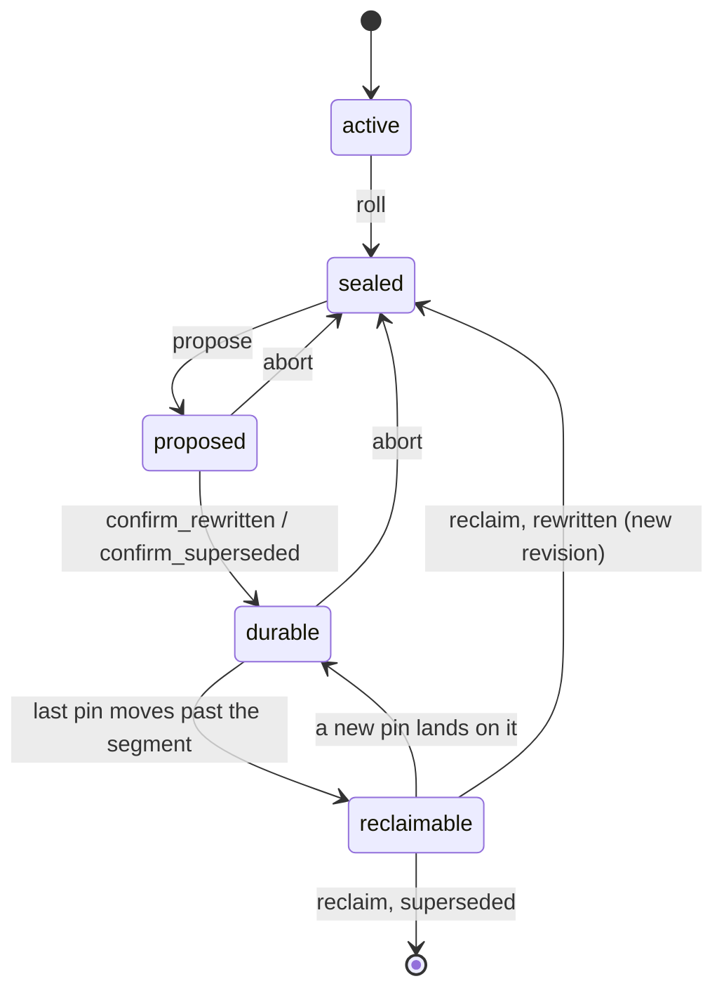
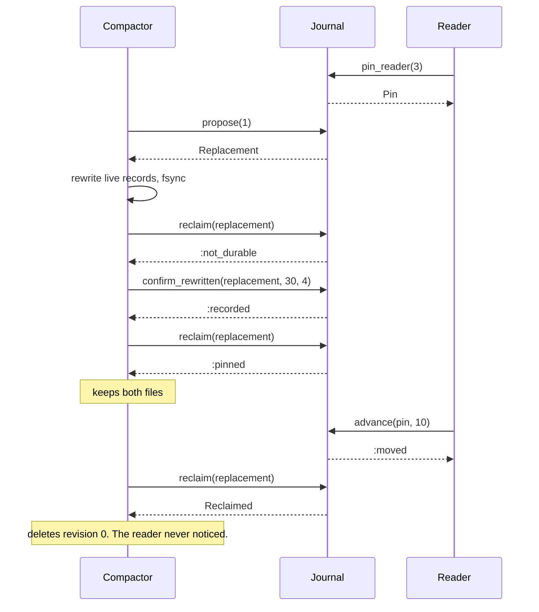

# JournalMachines

> Deleting a log segment is easy. Deleting it at the right time is the job.

Segment bookkeeping for a segmented log, in Ruby. You tell the journal what your log files look like: how big the active one is, which records in the old ones are dead, who is still reading, how far recovery has got. It tells you when to roll, which segments are worth compacting, and when an old file may finally be deleted. It never touches a file itself.

## Quick Start

```bash
gem 'journal_machines'
```

```ruby
HOUR = 3600 * 1_000_000_000   # time is Integer nanoseconds
clock = -> { Process.clock_gettime(Process::CLOCK_MONOTONIC, :nanosecond) }

# max_bytes, max_records, max_age, min_dead_per_mille. nil turns a threshold off.
policy = JournalMachines::Policy.new(64 * 1024 * 1024, nil, HOUR, 500)
journal = JournalMachines::Journal.new(policy, 0, clock.call)   # first offset 0, opened now
checkpoint = journal.pin_checkpoint(1, 0)   # recovery replays from offset 0

# Writer loop: ask before every append batch.
if journal.roll_decision(file.size, file.records, clock.call) != :keep
  file.fsync_and_close
  rolled = journal.roll(file.size, file.records, clock.call)
  file = open_segment(rolled.opened, rolled.next_offset)
end

# Compactor loop.
journal.compaction_candidates(nil, 64).each do |segment|
  replacement = journal.propose(segment.id)
  bytes, live = rewrite_and_fsync(segment)            # your code, your fsync
  journal.confirm_rewritten(replacement, bytes, live)
end

# Reaper loop: only what the journal lets go.
journal.reclaimable(nil, 64).each do |segment|
  reclaimed = journal.reclaim(segment.replacement)
  delete_file(reclaimed.segment, reclaimed.revision) if reclaimed.is_a?(JournalMachines::Reclaimed)
end
```

One journal, three loops. Offsets, sizes and times are Integers. Time is Integer nanoseconds on one monotonic clock, `Process.clock_gettime(Process::CLOCK_MONOTONIC, :nanosecond)`, for instants (`now`, a segment's `opened_at`) and spans (`max_age`) alike. No floats, no seconds, no `Time.now`.

## A Message to the Resistance

So you wrote an append-only log. Appending was the easy part. Then the disk filled, and you wrote a cleaner. The cleaner copied the live records of an old segment into a new file and deleted the old one.

Then a consumer that had been paused for an hour woke up holding a byte position into the file you deleted. So you added a check: don't delete while someone is reading. Then the machine lost power between the delete and the fsync of the new file, and the new file came back zero bytes long. So you added another check: fsync first. Then recovery replayed from the last checkpoint, which pointed into a segment the cleaner had judged finished. So you added a third check, in a third place, guarded by a third boolean.

Every one of those was the same rule, discovered one outage at a time. An original may go only when its replacement is durable *and* nobody who needs it is still behind it. The rule is small. The trouble is that it lived in three places and was enforced by remembering. This gem is the one place.

## Chapter 1: Stardate 2026.316, the AMS Rosenblum

> **AMS Rosenblum**, NCC-4228, *Rosenblum*-class archive cutter.
> Nothing leaves the hold until its copy is stowed and nobody is still reading it.

The archive cutter doesn't write the logbooks and doesn't shred them. It keeps the register of volumes: which one is open, which are closed, which have been recopied onto fresh stock, and who has one checked out. The shredder crew works from the register and from nothing else.

On a bridge somewhere, a cadet volunteers:

```ruby
def clean(segment)
  compacted = rewrite(segment)
  File.delete(segment.path)
  compacted
end
```

"That," says the cutter's archivist, "deletes the only copy between two lines, while the reader on deck four is halfway through it."

## The Flight Plan

Every segment the journal knows about is in one of these states:



And the afternoon the cleaner wanted segment 1 while a reader was still in it:



## How the Journal Works

### Roll

```ruby
policy = JournalMachines::Policy.new(100, 10, 50, 500)
policy.max_age                        # => 50
journal = JournalMachines::Journal.new(policy, 0, 1000)
journal.policy == policy              # => true

journal.roll_decision(99, 9, 1049)    # => :keep
journal.roll_decision(100, 9, 1000)   # => #<data JournalMachines::Due reason=:size>
journal.roll_decision(1, 10, 1000)    # => #<data JournalMachines::Due reason=:records>
journal.roll_decision(1, 1, 1050)     # => #<data JournalMachines::Due reason=:age>
journal.roll_decision(0, 0, 9999)     # => :keep, an empty segment is never due
```

`roll_decision` answers the core's `Roll`: the symbol `:keep`, or a `Due(reason)` naming the first threshold reached. It only reads. You pass what you observed about the active segment, bytes, records and the time, and it compares them with the thresholds, in that order. Leave a threshold out and it never triggers.

`now` and `max_age` are nanoseconds, so the segment above was opened at 1000 ns and is due by age 50 ns later. Real code passes the monotonic clock reading and a `max_age` like `30 * 60 * 1_000_000_000`. `segment.opened_at` reads back the same nanoseconds.

When you have actually sealed the file, say so:

```ruby
rolled = journal.roll(100, 9, 1000)
rolled.sealed        # => 1
rolled.opened        # => 2
rolled.next_offset   # => 9
```

`Policy.new(max_bytes, max_records, max_age, min_dead_per_mille)` holds the three roll thresholds and the dead-record ratio for compaction. `Journal.new(policy, base_offset, now)` opens one active segment at `base_offset`, at instant `now`. Neither has defaults: every argument is yours to choose. A threshold of `nil` never triggers. A threshold of zero, or a ratio above 1000, raises `RangeError` from `Policy.new`, so a bad policy never exists.

A roll doesn't have to be due. Sealing early is your call. Sealing an empty segment is `:empty`.

### Compaction candidates

The journal doesn't know which records are dead. You do, so you tell it:

```ruby
policy = JournalMachines::Policy.new(nil, nil, nil, 500)   # no roll thresholds, compact at half dead
journal = JournalMachines::Journal.new(policy, 0, 0)
3.times { journal.roll(100, 10, 0) }       # segments 1, 2, 3 sealed; 4 active

journal.observe_live(1, 5)                 # => :recorded, half dead
journal.observe_live(2, 6)                 # => :recorded, not dead enough
journal.observe_live(3, 0)                 # => :recorded, all dead

journal.compaction_candidates(nil, 64).map(&:id)          # => [1, 3]
journal.compaction_candidates(nil, 1).map(&:id)  # => [1]
journal.compaction_candidates(1, 1).map(&:id)    # => [3]
```

A sealed segment is a candidate when at least `min_dead_per_mille` of its stored records are dead (500 here, so half) and it has no replacement in flight. Candidates come oldest first, at most `limit` at a time. Pass the last id you handled to get the next batch.

### Replacement

```ruby
replacement = journal.propose(1)
replacement.class                              # => JournalMachines::Replacement
journal.segment(1).state                       # => :proposed
journal.propose(1)                             # => :busy

journal.confirm_rewritten(replacement, 40, 5)  # => :recorded
journal.confirm_rewritten(replacement, 40, 5)  # => :already_durable, a repeat
journal.confirm_rewritten(replacement, 41, 5)  # => :mismatch, that is not what was recorded
journal.confirm_superseded(replacement)        # => :mismatch
journal.segment(1).state                       # => :reclaimable
```

Confirming twice with the same numbers is not an error. The attempt is durable with exactly that, which is what you asked for, so the answer is `:already_durable`. Confirming it again with anything else, other bytes, another record count, or the other method, is `:mismatch`: the journal never recorded that, so it won't tell you it did. The first confirmation stands. If it was wrong, `abort` and propose again.

`propose` marks a segment as being replaced. `confirm_rewritten(replacement, bytes, live_records)` says a compacted copy of the same offsets is on disk and synced. `confirm_superseded(replacement)` says something else now covers the range, a snapshot or an archive, or nothing at all because every record was dead. The journal takes your word for it. It cannot see your disk.

The core has one call here, `confirm_durable(replacement, durable)`, where `durable` is `Rewritten { bytes, live_records }` or `Superseded`. Ruby has one method per variant, named after it and taking that variant's fields in order. Both answer `:recorded` the first time.

Changed your mind, or the rewrite failed?

```ruby
journal.abort(replacement)   # => :aborted
journal.segment(1).state     # => :sealed
journal.abort(replacement)   # => :stale
```

### Pins

A pin says "everything at or after this offset is still needed."

```ruby
journal = JournalMachines::Journal.new(policy, 0, 0)
2.times { journal.roll(100, 10, 0) }   # segment 1 holds 0...10, segment 2 holds 10...20

reader = journal.pin_reader(3)
reader.class                   # => JournalMachines::Pin
journal.low_pin                # => 3
journal.segment(1).pinned      # => true

journal.advance(reader, 10)    # => :moved
journal.advance(reader, 10)    # => :unchanged, already there
journal.advance(reader, 4)     # => :regressed
journal.segment(1).pinned      # => false

journal.release(reader)        # => :released
journal.release(reader)        # => :stale
journal.advance(reader, 11)    # => :stale
```

Release is checked against the acquisition, not the slot. Once released, a pin handle never names a pin again, even after the journal hands the same slot to someone else: `advance`, `checkpoint` and `pin_offset` answer `:stale` (or `nil`) and leave the new holder alone. A second `release` is `:stale` too, and changes nothing. The journal keeps no list of released pins, and it can't work the answer out: pins, segments and attempts are numbered from one sequence, so "one of my numbers that no pin holds" is just as true of a segment id. It only honours a repeat it can prove. A pin it never issued, from a journal of another scope or with a number it hasn't reached, is `:stale` as well.

Moving a pin to where it already sits is `:unchanged`, an answer and not a refusal. Moving it back is `:regressed`, a refusal: the journal may already have let go of what lies behind the pin, so it cannot promise it again.

A checkpoint pin also carries the generation of the consumer assignment that reported it:

```ruby
checkpoint = journal.pin_checkpoint(3, 20)   # assignment generation 3, offset 20

journal.checkpoint(checkpoint, 3, 25)   # => :advanced
journal.checkpoint(checkpoint, 2, 99)   # => :stale_assignment
journal.checkpoint(checkpoint, 4, 8)    # => :reassigned
journal.pin_offset(checkpoint)          # => 8
```

A consumer that was fenced off can't drag retention forward with an offset it committed before it lost the partition. A newer assignment takes over at whatever offset it reports, even a lower one.

If the generation and the offset come from an offset tracker, hand over the tracker instead of two loose integers:

```ruby
tracker = OffsetMachines::Tracker.new       # gem 'offset_machines'
journal.pin_checkpoint_from(tracker)        # => :unassigned, nothing pinned

tracker.assign(3, 20)
checkpoint = journal.pin_checkpoint_from(tracker)
journal.pin_offset(checkpoint)              # => 20

tracker.ack(3, 20)                          # acknowledged, not committed
journal.checkpoint_from(checkpoint, tracker)   # => :unchanged
tracker.mark_committed(3, 21)
journal.checkpoint_from(checkpoint, tracker)   # => :advanced, now at 21

zombie = OffsetMachines::Tracker.new
zombie.assign(2, 99)
journal.checkpoint_from(checkpoint, zombie)    # => :stale_assignment
```

`pin_checkpoint_from(tracker)` is `pin_checkpoint(tracker.generation, tracker.base)` and `checkpoint_from(pin, tracker)` is `checkpoint(pin, tracker.generation, tracker.base)`, with the same answers. Both numbers are read from the one object you pass, so they can't come from two different trackers. This gem doesn't depend on `offset_machines`: any object with `generation` and `base` readers fits, `OffsetMachines::Tracker` being the one they were written for. Anything without them raises `TypeError`.

### Reclaim

```ruby
journal = JournalMachines::Journal.new(policy, 0, 0)
journal.roll(100, 10, 0)
reader = journal.pin_reader(3)
replacement = journal.propose(1)

journal.reclaim(replacement)                    # => :not_durable
journal.confirm_rewritten(replacement, 30, 4)   # => :recorded
journal.reclaim(replacement)                    # => :pinned
journal.reclaimable(nil, 64)                             # => []

journal.advance(reader, 10)                     # => :moved
reclaimed = journal.reclaim(replacement)
reclaimed.revision      # => 0, the file to delete
reclaimed.bytes         # => 100
reclaimed.replaced_by   # => 4, the revision now serving 0...10: the attempt number
```

Two conditions, both required: the replacement is confirmed durable, and no pin of either kind sits below the segment's end. Miss one and you get a symbol and nothing changes. A rewritten segment keeps its id and its offsets under a new revision. A superseded one leaves the journal and `replaced_by` is `nil`.

### Capacity

The journal tracks 64 segments and 32 pins. Past that it refuses:

```ruby
journal = JournalMachines::Journal.new(policy, 0, 0)
journal.segment_capacity          # => 64
63.times { journal.roll(1, 1, 0) }
journal.roll(1, 1, 0)             # => :segments_full

32.times { journal.pin_reader(0) }
journal.pin_reader(0)             # => :pins_full
```

A `:segments_full` roll means your writer keeps appending to the segment it has until you reclaim something. Nothing is dropped to make room.

### Time only moves forward

```ruby
journal = JournalMachines::Journal.new(JournalMachines::Policy.new(nil, nil, 10, 500), 0, 100)
journal.roll_decision(1, 1, 99)   # => :time_regression
journal.roll(1, 1, 99)            # => :time_regression
```

A clock reading earlier than the moment the active segment was opened is refused, not guessed at.

### Every answer

A call that is honoured answers with a value. A call that is not honoured answers with one of the refusal symbols below, and only those, and changes nothing. A repeat of something that already holds is honoured: it gets its own answer in the Honoured column, marked *repeat*, and it changes nothing either.

| Call | Honoured | Refusals |
| --- | --- | --- |
| `roll_decision(bytes, records, now)` | `:keep`, `Due(:size)`, `Due(:records)`, `Due(:age)` | `:time_regression`, `:overflow`, `:no_active` |
| `roll(bytes, records, now)` | `Rolled` | `:empty`, `:time_regression`, `:overflow`, `:segments_full`, `:exhausted`, `:no_active` |
| `observe_live(id, live_records)` | `:recorded` | `:unknown`, `:active`, `:exceeds` |
| `pin_reader(offset)` | `Pin` | `:pins_full`, `:exhausted` |
| `pin_checkpoint(assignment, offset)`, `pin_checkpoint_from(tracker)` | `Pin` | `:unassigned`, `:pins_full`, `:exhausted` |
| `advance(pin, offset)` | `:moved`, `:unchanged` (*repeat*) | `:stale`, `:wrong_kind`, `:regressed` |
| `checkpoint(pin, assignment, offset)`, `checkpoint_from(pin, tracker)` | `:advanced`, `:reassigned`, `:unchanged` (*repeat*) | `:stale`, `:wrong_kind`, `:unassigned`, `:stale_assignment`, `:regressed` |
| `release(pin)` | `:released` | `:stale` |
| `propose(id)` | `Replacement` | `:unknown`, `:active`, `:busy`, `:exhausted` |
| `confirm_rewritten(replacement, bytes, live_records)` | `:recorded`, `:already_durable` (*repeat*) | `:stale`, `:mismatch`, `:exceeds` |
| `confirm_superseded(replacement)` | `:recorded`, `:already_durable` (*repeat*) | `:stale`, `:mismatch` |
| `reclaim(replacement)` | `Reclaimed` | `:stale`, `:not_durable`, `:pinned` |
| `abort(replacement)` | `:aborted` | `:stale` |

Each refusal is the snake_case of one core `Refusal` variant. There is no catch-all symbol.

The repeats. Only one the journal can prove from its own state is honoured:

| Repeat | Meaning |
| --- | --- |
| `:unchanged` | The pin already sits at that offset (for a checkpoint: under that same assignment generation). |
| `:already_durable` | This attempt was confirmed before by the same method with the same bytes and record count. |

Each refusal means one thing wherever it shows up:

| Refusal | Meaning |
| --- | --- |
| `:no_active` | There is no active segment. Not reachable with the compiled capacity of 64. |
| `:empty` | The active segment holds no records, so there is nothing to seal. |
| `:time_regression` | `now` is earlier than the moment the active segment was opened. |
| `:overflow` | The offset range would pass `2**64 - 1`. |
| `:segments_full` | All 64 segment slots are taken. Reclaim one. |
| `:pins_full` | All 32 pin slots are held. Release one. |
| `:exhausted` | The journal ran out of numbers for segment ids, pin generations and attempts. That takes `2**48 - 1` of them, all kinds together, per scope. |
| `:unknown` | No segment has that id. |
| `:active` | That is the active segment, still being written. |
| `:busy` | The segment already has a replacement in flight. |
| `:exceeds` | More live records than the segment stores. |
| `:mismatch` | The attempt is already durable, but not with this: `confirm_superseded` after `confirm_rewritten` or the reverse, or `confirm_rewritten` with other bytes or another record count. The first confirmation stands. |
| `:stale` | The `Pin` or `Replacement` is not current: released, aborted, reclaimed, superseded by a newer attempt, or one this journal never issued (another scope, or a number it hasn't reached). Releasing a pin twice is `:stale`. |
| `:wrong_kind` | `advance` on a checkpoint pin, or `checkpoint` on a reader pin. |
| `:unassigned` | Assignment generation zero is not an assignment. |
| `:stale_assignment` | The assignment generation is older than the one the checkpoint holds. |
| `:regressed` | The offset is behind the pin. |
| `:not_durable` | The replacement hasn't been confirmed durable. |
| `:pinned` | A pin still sits below the segment's end. |

The queries `active`, `segment`, `covering`, `segments`, `compaction_candidates`, `reclaimable`, `pin_offset`, `low_pin`, `pins`, `policy`, `size`, `empty?`, `segment_capacity` and `pin_capacity` never refuse. They answer a value, `nil` or an empty array. `segments(after, limit)`, `compaction_candidates(after, limit)` and `reclaimable(after, limit)` take both arguments every time: `after` is the last segment id you were given, or `nil` to begin, and `limit` bounds the Array (the core hands out an iterator instead).

## The Rules of the Archivist

- **Everything is an Integer** in `0..2**64-1`: offsets, sizes, counts, times, ids, generations. Floats, nil, and strings raise `TypeError`. Out of range raises `RangeError`. A threshold may be `nil`, never zero. A missing argument raises `ArgumentError`: nothing has a default.
- **Time is Integer nanoseconds.** `now` (in `Journal.new`, `roll_decision` and `roll`), `max_age` and `Segment#opened_at` are nanoseconds on one monotonic clock: `Process.clock_gettime(Process::CLOCK_MONOTONIC, :nanosecond)`. A Float or any other non-Integer raises `TypeError`; a negative value or one past `2**64-1` raises `RangeError`.
- **Scopes.** A `Pin`, a `Replacement` and a segment id are only meaningful to the `Journal` that issued them. They are numbered from 1, so two journals hand out the same ones, and a handle given to the wrong journal would name a live pin or attempt there. One journal never repeats itself, though: segment ids, pin generations and attempt numbers come from a single sequence (the first segment is 1, and every roll, pin and proposal takes the next number), so a generation or an attempt passed where a segment id goes names no segment. Segment ids still ascend; they aren't consecutive. Give each journal its own scope: `Journal.with_scope(policy, base_offset, now, scope)`, any Integer in `0..65_535` (a non-Integer raises `TypeError`, anything outside the range raises `RangeError`). `Journal.new(policy, base_offset, now)` is scope zero. The scope rides in the top 16 bits of every segment id, pin generation and attempt number (and so of a rewritten segment's `revision`); `journal.scope`, `pin.scope` and `replacement.scope` read it back. A journal that never issued it, of another scope or not that far along, answers `:stale` to a pin or replacement (`nil` from `pin_offset`) and `:unknown` to a segment id (`nil` from `segment`, `[]` from the scans), and changes nothing. The journal can't pick a scope for you, and two journals left in the same scope still mix up each other's handles. `Pin` and `Replacement` objects can't be built by hand.
- **Refusals don't raise.** `:segments_full`, `:pinned`, `:not_durable`, `:stale` and the rest are answers. A refused call changes nothing. Only malformed input raises.
- **Restarts.** A journal built again with `new` or `with_scope` numbers from 1 again, so a pin or replacement that outlived the restart could name a new entry. Either resume the numbering, `Journal.resumed(policy, base_offset, now, scope, issued)` with the `journal.issued` you saved from the journal before it, or give each incarnation its own scope. `resumed` restores the numbering and nothing else: segments and pins are yours to replay, and the one active segment takes the next number. It raises `RangeError` for an `issued` outside `0..2**48-2`. Save `issued` before you hand a number out: resuming from too low a count reissues.
- **Repeats aren't refusals, when they can be proved.** `:unchanged` and `:already_durable` mean the journal can see that exactly what you asked for was already done. Treat them as success. They change nothing. A repeat it can't prove is refused: a second `release`, `reclaim` or `abort` is `:stale` (it keeps neither the pins it released nor how an attempt ended), a second confirmation with different contents is `:mismatch`.
- **No pins means no objection.** The journal protects what is pinned. If nobody pinned a checkpoint, nothing stops a durable replacement from being reclaimed.
- **Frozen means frozen.** `freeze` the journal and every mutating call raises `FrozenError`.

## What You Think You're Doing vs Reality

### You Think: "The compacted file is written, so the old one can go."
### Reality: Written is not durable, and durable is not unread.

A file you wrote and didn't sync is a promise from the page cache. A file you synced can still be the wrong one to keep alone, if a reader holds a position in the original or recovery intends to replay through it. `reclaim` won't say yes until you've confirmed the first and every pin has cleared the second.

### You Think: "The consumer acknowledged it, so the checkpoint can move."
### Reality: Acknowledged is not committed.

Move the checkpoint pin to the offset your commit actually persisted, not to the one a worker says it finished. `pin_checkpoint_from` and `checkpoint_from` pair with `offset_machines` for exactly this: they pin at the tracker's confirmed base, never at what was merely acknowledged.

## What's Yours

Everything that touches a disk. You write the records, seal the files, rewrite the compacted copies, fsync, and delete. The journal keeps metadata in your process and loses it when the process dies. After a restart, rebuild a journal from what's on disk and from your own durable manifest (see Restarts above for its numbering), then re-pin readers and checkpoints before letting the reaper run. A half-finished replacement found on disk after a crash is yours to finish or discard. This is not a log writer, not a byte compactor and not a Raft log. It's an initial release and the API will move.

## License

MIT License. See [LICENSE.txt](LICENSE.txt) for details.

**Remember: anyone can delete a file. The question is whether someone was still reading it.**
