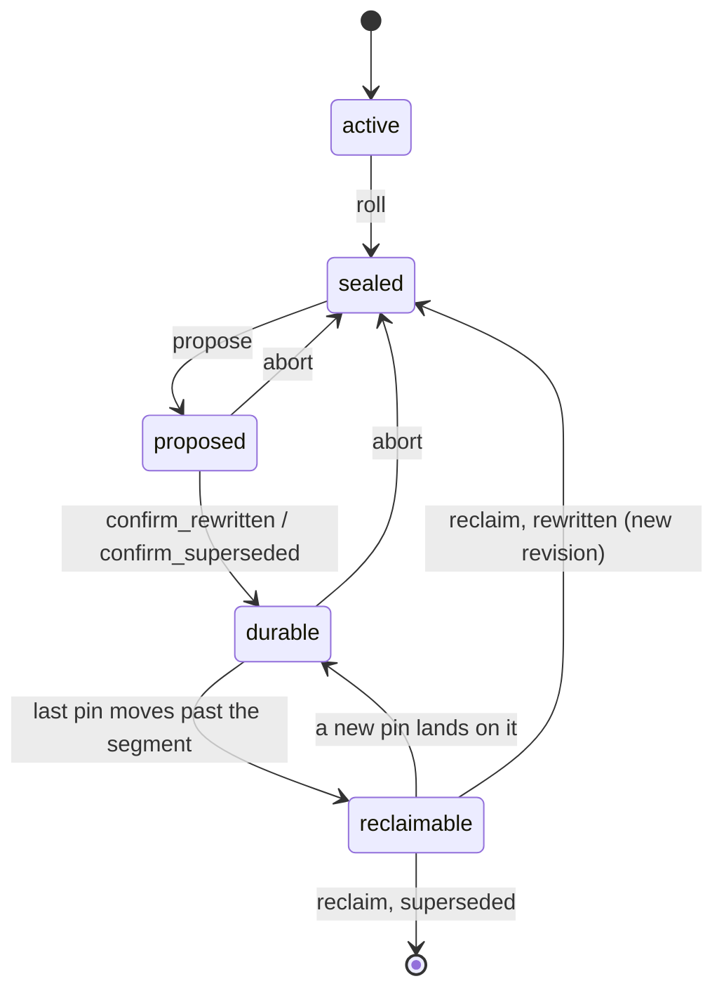
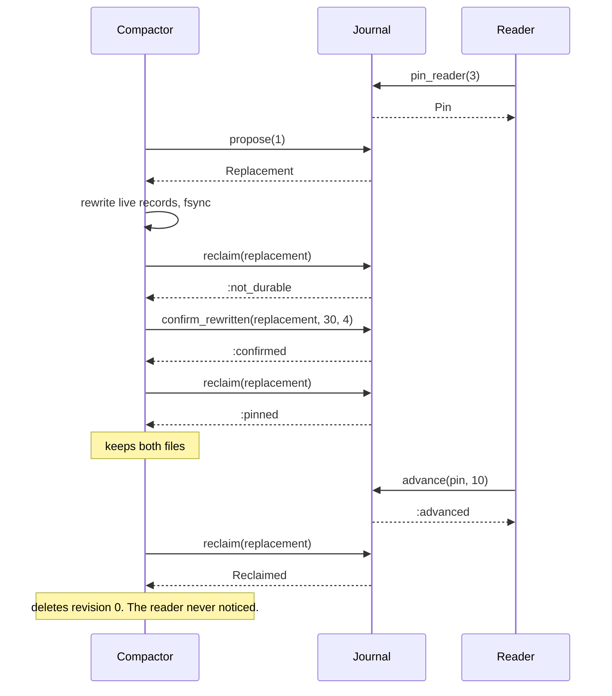

# JournalMachines

> Deleting a log segment is easy. Deleting it at the right time is the job.

Segment bookkeeping for a segmented log, in Ruby. You tell the journal what your log files look like: how big the active one is, which records in the old ones are dead, who is still reading, how far recovery has got. It tells you when to roll, which segments are worth compacting, and when an old file may finally be deleted. It never touches a file itself.

## Quick Start

```bash
gem 'journal_machines'
```

```ruby
journal = JournalMachines::Journal.new(max_bytes: 64 * 1024 * 1024, max_age: 3600)
checkpoint = journal.pin_checkpoint(1, 0)   # recovery replays from offset 0

# Writer loop: ask before every append batch.
if journal.roll_decision(file.size, file.records, clock.now) != :keep
  file.fsync_and_close
  rolled = journal.roll(file.size, file.records, clock.now)
  file = open_segment(rolled.opened, rolled.next_offset)
end

# Compactor loop.
journal.compaction_candidates.each do |segment|
  replacement = journal.propose(segment.id)
  bytes, live = rewrite_and_fsync(segment)            # your code, your fsync
  journal.confirm_rewritten(replacement, bytes, live)
end

# Reaper loop: only what the journal lets go.
journal.reclaimable.each do |segment|
  reclaimed = journal.reclaim(segment.replacement)
  delete_file(reclaimed.segment, reclaimed.revision) if reclaimed.is_a?(JournalMachines::Reclaimed)
end
```

One journal, three loops. Offsets, sizes and times are Integers. Time is whatever unit your clock counts in, as long as `max_age` uses the same one.

## A Message to the Resistance

So you wrote an append-only log. Appending was the easy part. Then the disk filled, and you wrote a cleaner. The cleaner copied the live records of an old segment into a new file and deleted the old one.

Then a consumer that had been paused for an hour woke up holding a byte position into the file you deleted. So you added a check: don't delete while someone is reading. Then the machine lost power between the delete and the fsync of the new file, and the new file came back zero bytes long. So you added another check: fsync first. Then recovery replayed from the last checkpoint, which pointed into a segment the cleaner had judged finished. So you added a third check, in a third place, guarded by a third boolean.

Every one of those was the same rule, discovered one outage at a time. An original may go only when its replacement is durable *and* nobody who needs it is still behind it. The rule is small. The trouble is that it lived in three places and was enforced by remembering. This gem is the one place.

## Chapter 1: Stardate 2026.316, the AMS Rosenblum

> **AMS Rosenblum**, NCC-4228, *Rosenblum*-class archive cutter.
> Nothing leaves the hold until its copy is stowed and nobody is still reading it.

The archive cutter doesn't write the logbooks and doesn't shred them. It keeps the register of volumes: which one is open, which are closed, which have been recopied onto fresh stock, and who has one checked out. The shredder crew works from the register and from nothing else.

On a bridge somewhere, a cadet volunteers:

```ruby
def clean(segment)
  compacted = rewrite(segment)
  File.delete(segment.path)
  compacted
end
```

"That," says the cutter's archivist, "deletes the only copy between two lines, while the reader on deck four is halfway through it."

## The Flight Plan

Every segment the journal knows about is in one of these states:



And the afternoon the cleaner wanted segment 1 while a reader was still in it:



## How the Journal Works

### Roll

```ruby
journal = JournalMachines::Journal.new(now: 1000, max_bytes: 100, max_records: 10, max_age: 50)

journal.roll_decision(99, 9, 1049)    # => :keep
journal.roll_decision(100, 9, 1000)   # => :size
journal.roll_decision(1, 10, 1000)    # => :records
journal.roll_decision(1, 1, 1050)     # => :age
journal.roll_decision(0, 0, 9999)     # => :keep, an empty segment is never due
```

`roll_decision` only reads. You pass what you observed about the active segment, bytes, records and the time, and it compares them with the thresholds, in that order. Leave a threshold out and it never triggers.

When you have actually sealed the file, say so:

```ruby
rolled = journal.roll(100, 9, 1000)
rolled.sealed        # => 1
rolled.opened        # => 2
rolled.next_offset   # => 9
```

A roll doesn't have to be due. Sealing early is your call. Sealing an empty segment is `:empty`.

### Compaction candidates

The journal doesn't know which records are dead. You do, so you tell it:

```ruby
journal = JournalMachines::Journal.new
3.times { journal.roll(100, 10, 0) }       # segments 1, 2, 3 sealed; 4 active

journal.observe_live(1, 5)                 # => :recorded, half dead
journal.observe_live(2, 6)                 # => :recorded, not dead enough
journal.observe_live(3, 0)                 # => :recorded, all dead

journal.compaction_candidates.map(&:id)          # => [1, 3]
journal.compaction_candidates(nil, 1).map(&:id)  # => [1]
journal.compaction_candidates(1, 1).map(&:id)    # => [3]
```

A sealed segment is a candidate when at least `min_dead_per_mille` of its stored records are dead (500 by default, so half) and it has no replacement in flight. Candidates come oldest first, at most `limit` at a time. Pass the last id you handled to get the next batch.

### Replacement

```ruby
replacement = journal.propose(1)
replacement.class                              # => JournalMachines::Replacement
journal.segment(1).state                       # => :proposed
journal.propose(1)                             # => :busy

journal.confirm_rewritten(replacement, 40, 5)  # => :confirmed
journal.segment(1).state                       # => :reclaimable
```

`propose` marks a segment as being replaced. `confirm_rewritten(replacement, bytes, live_records)` says a compacted copy of the same offsets is on disk and synced. `confirm_superseded(replacement)` says something else now covers the range, a snapshot or an archive, or nothing at all because every record was dead. The journal takes your word for it. It cannot see your disk.

Changed your mind, or the rewrite failed?

```ruby
journal.abort(replacement)   # => :aborted
journal.segment(1).state     # => :sealed
journal.abort(replacement)   # => :stale
```

### Pins

A pin says "everything at or after this offset is still needed."

```ruby
journal = JournalMachines::Journal.new
2.times { journal.roll(100, 10, 0) }   # segment 1 holds 0...10, segment 2 holds 10...20

reader = journal.pin_reader(3)
reader.class                   # => JournalMachines::Pin
journal.low_pin                # => 3
journal.segment(1).pinned      # => true

journal.advance(reader, 10)    # => :advanced
journal.advance(reader, 4)     # => :regressed
journal.segment(1).pinned      # => false

journal.release(reader)        # => :released
journal.release(reader)        # => :stale
```

Release is checked against the acquisition, not the slot. Once released, a pin handle is dead for good, even after the journal hands the same slot to someone else.

A checkpoint pin also carries the generation of the consumer assignment that reported it:

```ruby
checkpoint = journal.pin_checkpoint(3, 20)   # assignment generation 3, offset 20

journal.checkpoint(checkpoint, 3, 25)   # => :advanced
journal.checkpoint(checkpoint, 2, 99)   # => :stale_assignment
journal.checkpoint(checkpoint, 4, 8)    # => :reassigned
journal.pin_offset(checkpoint)          # => 8
```

A consumer that was fenced off can't drag retention forward with an offset it committed before it lost the partition. A newer assignment takes over at whatever offset it reports, even a lower one.

If the generation and the offset come from an offset tracker, hand over the tracker instead of two loose integers:

```ruby
tracker = OffsetMachines::Tracker.new       # gem 'offset_machines'
journal.pin_checkpoint_from(tracker)        # => :unassigned, nothing pinned

tracker.assign(3, 20)
checkpoint = journal.pin_checkpoint_from(tracker)
journal.pin_offset(checkpoint)              # => 20

tracker.ack(3, 20)                          # acknowledged, not committed
journal.checkpoint_from(checkpoint, tracker)   # => :unchanged
tracker.mark_committed(3, 21)
journal.checkpoint_from(checkpoint, tracker)   # => :advanced, now at 21

zombie = OffsetMachines::Tracker.new
zombie.assign(2, 99)
journal.checkpoint_from(checkpoint, zombie)    # => :stale_assignment
```

`pin_checkpoint_from(tracker)` is `pin_checkpoint(tracker.generation, tracker.base)` and `checkpoint_from(pin, tracker)` is `checkpoint(pin, tracker.generation, tracker.base)`, with the same answers. Both numbers are read from the one object you pass, so they can't come from two different trackers. This gem doesn't depend on `offset_machines`: any object with `generation` and `base` readers fits, `OffsetMachines::Tracker` being the one they were written for. Anything without them raises `TypeError`.

### Reclaim

```ruby
journal = JournalMachines::Journal.new
journal.roll(100, 10, 0)
reader = journal.pin_reader(3)
replacement = journal.propose(1)

journal.reclaim(replacement)                    # => :not_durable
journal.confirm_rewritten(replacement, 30, 4)   # => :confirmed
journal.reclaim(replacement)                    # => :pinned
journal.reclaimable                             # => []

journal.advance(reader, 10)                     # => :advanced
reclaimed = journal.reclaim(replacement)
reclaimed.revision      # => 0, the file to delete
reclaimed.bytes         # => 100
reclaimed.replaced_by   # => 1, the revision now serving 0...10
```

Two conditions, both required: the replacement is confirmed durable, and no pin of either kind sits below the segment's end. Miss one and you get a symbol and nothing changes. A rewritten segment keeps its id and its offsets under a new revision. A superseded one leaves the journal and `replaced_by` is `nil`.

### Capacity

The journal tracks 64 segments and 32 pins. Past that it refuses:

```ruby
journal = JournalMachines::Journal.new
journal.capacity                  # => 64
63.times { journal.roll(1, 1, 0) }
journal.roll(1, 1, 0)             # => :full

32.times { journal.pin_reader(0) }
journal.pin_reader(0)             # => :full
```

A `:full` roll means your writer keeps appending to the segment it has until you reclaim something. Nothing is dropped to make room.

### Time only moves forward

```ruby
journal = JournalMachines::Journal.new(now: 100, max_age: 10)
journal.roll_decision(1, 1, 99)   # => :time_regression
journal.roll(1, 1, 99)            # => :time_regression
```

A clock reading earlier than the moment the active segment was opened is refused, not guessed at.

## The Rules of the Archivist

- **Everything is an Integer** in `0..2**64-1`: offsets, sizes, counts, times, ids, generations. Floats, nil, and strings raise `TypeError`. Out of range raises `RangeError`. A threshold may be `nil`, never zero.
- **Handles belong to one journal.** A `Pin` or `Replacement` from one `Journal` is `:stale` to another. Handles can't be built by hand.
- **Refusals don't raise.** `:full`, `:pinned`, `:not_durable`, `:stale` and the rest are answers. A refused call changes nothing. Only malformed input raises.
- **No pins means no objection.** The journal protects what is pinned. If nobody pinned a checkpoint, nothing stops a durable replacement from being reclaimed.
- **Frozen means frozen.** `freeze` the journal and every mutating call raises `FrozenError`.

## What You Think You're Doing vs Reality

### You Think: "The compacted file is written, so the old one can go."
### Reality: Written is not durable, and durable is not unread.

A file you wrote and didn't sync is a promise from the page cache. A file you synced can still be the wrong one to keep alone, if a reader holds a position in the original or recovery intends to replay through it. `reclaim` won't say yes until you've confirmed the first and every pin has cleared the second.

### You Think: "The consumer acknowledged it, so the checkpoint can move."
### Reality: Acknowledged is not committed.

Move the checkpoint pin to the offset your commit actually persisted, not to the one a worker says it finished. `pin_checkpoint_from` and `checkpoint_from` pair with `offset_machines` for exactly this: they pin at the tracker's confirmed base, never at what was merely acknowledged.

## What's Yours

Everything that touches a disk. You write the records, seal the files, rewrite the compacted copies, fsync, and delete. The journal keeps metadata in your process and loses it when the process dies. After a restart, rebuild a fresh journal from what's on disk and from your own durable manifest, then re-pin readers and checkpoints before letting the reaper run. A half-finished replacement found on disk after a crash is yours to finish or discard. This is not a log writer, not a byte compactor and not a Raft log. It's an initial release and the API will move.

## License

MIT License. See [LICENSE.txt](LICENSE.txt) for details.

**Remember: anyone can delete a file. The question is whether someone was still reading it.**
